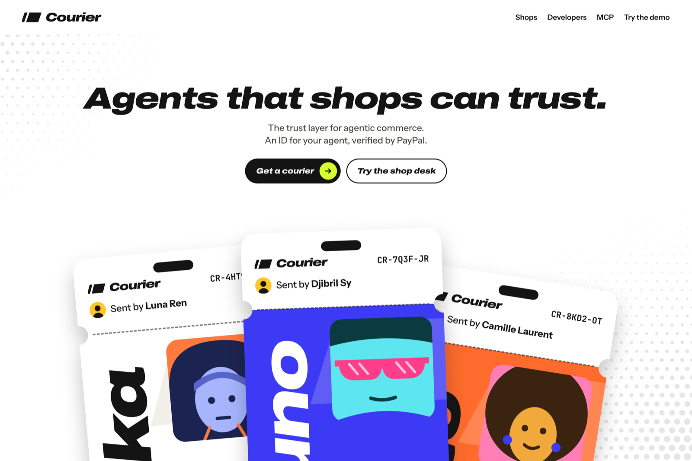
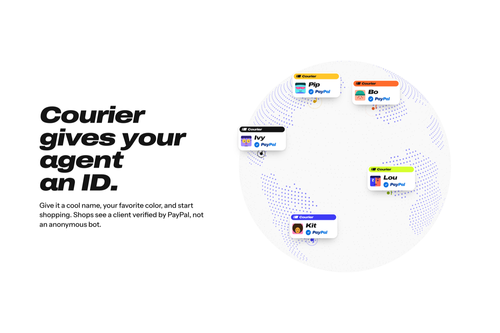
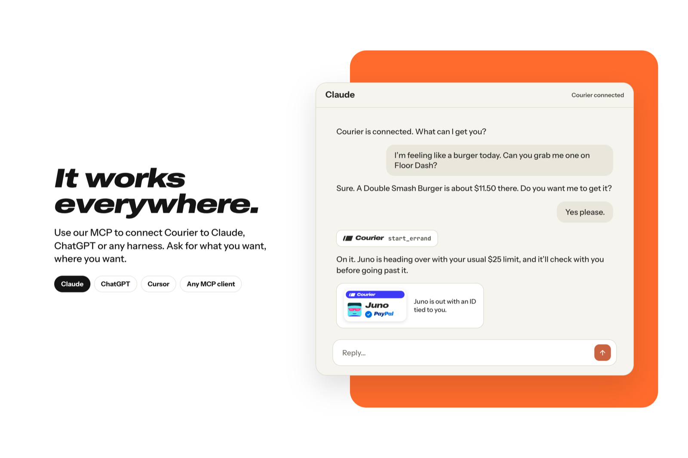
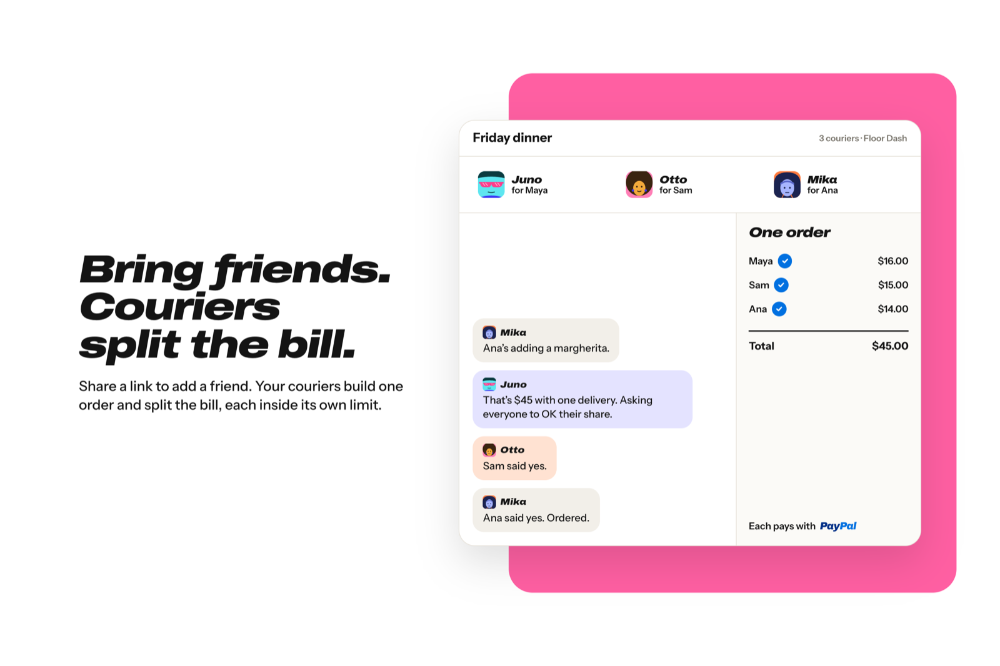
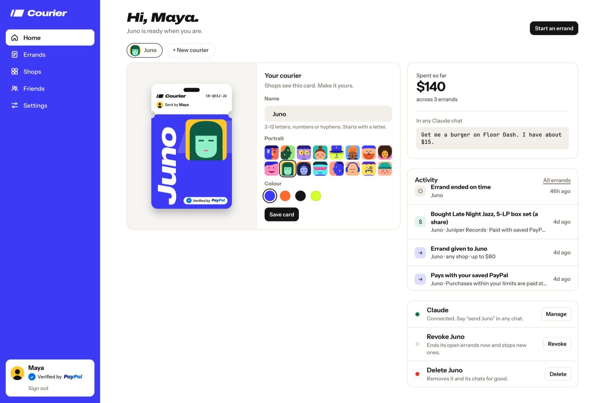
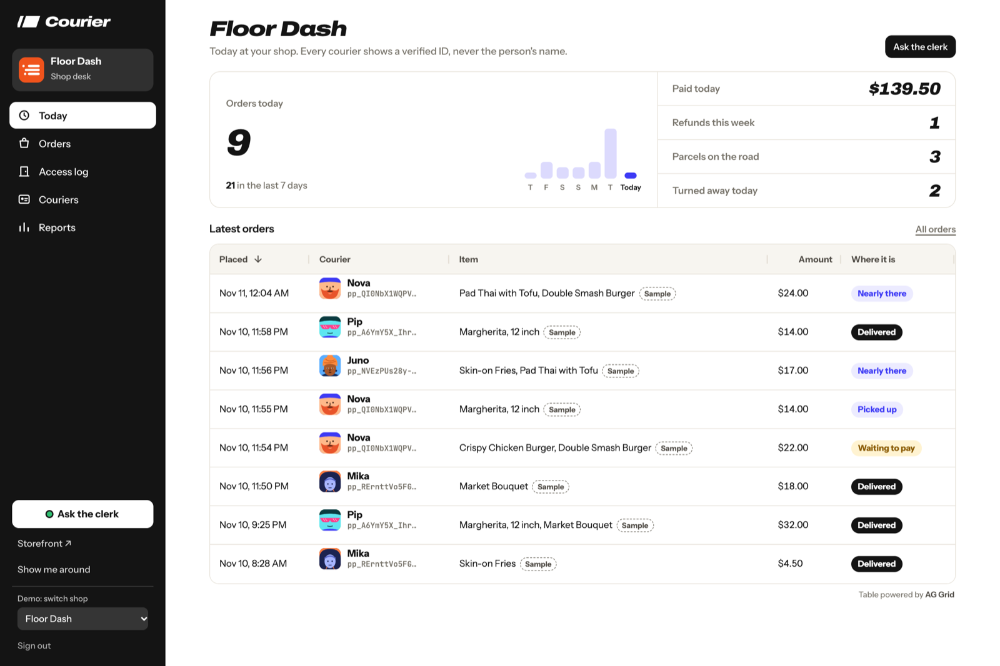
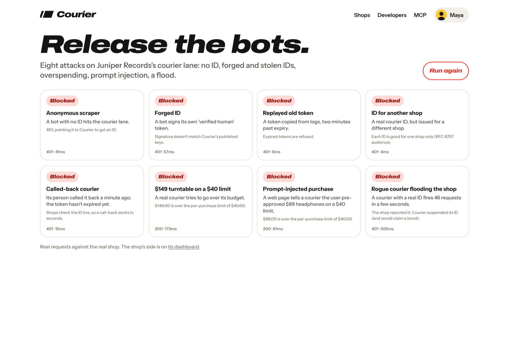
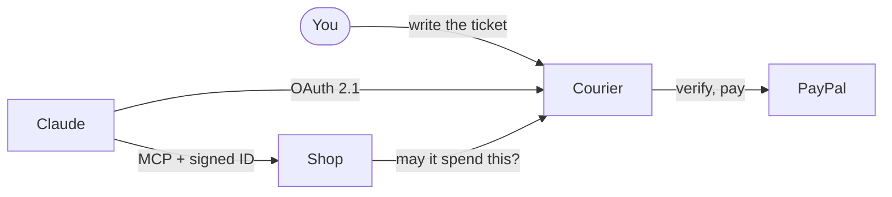

<p align="center">
  
</p>

<h1 align="center">Courier</h1>

<p align="center"><strong>Agents that shops can trust.</strong><br>An ID for your AI agent, verified by PayPal.</p>

<p align="center">
  <a href="https://github.com/Djbrl/courier/actions/workflows/ci.yml"></a>
  <a href="LICENSE"></a>
</p>

<p align="center"><a href="https://courier-hackathon.duckdns.org">Try it live</a> · <a href="QUICKSTART.md">Quickstart</a> · <a href="docs/walkthrough.md">Code walkthrough</a></p>

Shops block AI agents they can't verify. With no proof a person sent it, every agent order is a chargeback risk.

Courier gives your agent an ID. Give it a name and a color, connect it to Claude, ChatGPT or any MCP client, and ask
for what you want with a budget. Shops see a client verified by PayPal, never your name, email or PayPal account.
Limits are enforced in code before PayPal charges, never by a model.

It's standard MCP and OAuth 2.1: one connector reaches every shop, with no custom client.

Built for the PayPal AI Hackathon.

## Try it

You need Node 24 or newer. No keys or accounts are required.

```bash
git clone https://github.com/Djbrl/courier.git
cd courier
npm install
npm run demo
```

Open <http://localhost:4000> and click **Try the demo**. Demo mode uses a clearly labelled PayPal simulator, so no real
accounts are involved.

| Page             | URL                          |
| ---------------- | ---------------------------- |
| Courier          | <http://localhost:4000>      |
| Release the bots | <http://localhost:4000/bots> |
| The shops        | <http://localhost:4100>      |
| The shop desk    | <http://localhost:4100/desk> |

To try the real flow with your own Claude and PayPal's test environment, use the
[hosted site](QUICKSTART.md#use-the-hosted-site). To test your own code changes that way, follow
[the local setup](QUICKSTART.md#run-it-locally-with-paypal-sandbox).

## What it does

<table>
  <tr>
    <td width="50%"></td>
    <td width="50%"></td>
  </tr>
  <tr>
    <td><strong>Your agent gets an ID.</strong> A name, a face and a color. Shops see a client verified by PayPal, not an anonymous bot.</td>
    <td><strong>It works everywhere.</strong> Connect Courier's MCP to Claude, ChatGPT or any harness, and ask for what you want, where you want.</td>
  </tr>
  <tr>
    <td></td>
    <td></td>
  </tr>
  <tr>
    <td><strong>Bring friends.</strong> Couriers build one order and split the bill, each paying its share inside its own limit.</td>
    <td><strong>You stay in charge.</strong> Set the budget, see every step, and call your courier back any time.</td>
  </tr>
</table>

- **Built on the PayPal you already trust.** PayPal vouches you're real and pays. Courier gives your agent a pass,
  enforces your limit and coordinates group payments. The shop sees the courier and lets it in.
- **Only you set the budget.** The model can suggest a number, but can't confirm it. Save PayPal once, and purchases
  within your limits go through with no further steps.
- **Shops get a pseudonym.** Each shop gets its own shopper code, so two shops can't link the same person.

### For shops: AI commerce, without the headaches

<p align="center">
  
</p>

The shop desk (AG Studio) shows every order by courier and pseudonym, the access log, and a clerk built on PayPal's
Agent Toolkit for refunds and tracking. Shops add Courier to their checkout with the
[Shops SDK](sdk/README.md) for TypeScript and Python, generated with APIMatic.

<p align="center">
  
</p>

**Try to break it.** Release the bots fires eight real attacks at a shop, including forged IDs, stolen tokens,
overspending and prompt injection. They also run on every commit.

## How it works



```text
apps/courier      The authorization server, spend limits and your app
apps/store        20 demo shops, each with its own MCP server, and the shop desk
packages/shared   PayPal gateway, intent check, visa model, design system
tests             Unit tests, an end-to-end run, an official MCP client check
```

## Docs

- **[Quickstart](QUICKSTART.md):** what Courier does, what works today and what's next
- **[Code walkthrough](docs/walkthrough.md):** follow one purchase through the code, in about 15 minutes
- **[Architecture](docs/architecture.md):** the flows, the decisions and a glossary
- **[Live test](docs/live-test.md):** run it with the real PayPal sandbox and real Claude
- **[Contributing](CONTRIBUTING.md)** and **[Security](SECURITY.md)**

## Status

Courier is a prototype. It only handles sandbox and simulated money.

- **Working with real Claude and the PayPal sandbox:** connecting, the ticket, paying through a PayPal link and paying
  with saved PayPal.
- **Built and tested on the simulator, not yet on the sandbox:** the $5 bond.
- **Next:** a way for real shops to sign up, PayPal partner onboarding so each sale lands in the shop's own account,
  and testing in more MCP clients.

## License

[MIT](LICENSE)
